<p align="center">
  
</p>

<p align="center">
  
</p>

<p align="center">
  
  <a href="https://github.com/henriquedevops?tab=followers"></a>
</p>

## 👾 Sobre mim

Gosto de pegar um modelo que funciona no notebook e transformar em algo que roda de verdade: com API, container, pipeline de retreino e, principalmente, **monitoramento**. Hoje estudo Machine Learning Engineering na FIAP e uso este GitHub como laboratório.

```python
class Henrique:
    cargo     = "Machine Learning Engineer"
    estudando = "ML Engineering @ FIAP"
    foco      = ["MLOps", "observabilidade de modelos", "LLMs locais"]
    stack     = {
        "ml":      ["PyTorch", "scikit-learn", "MLflow", "DVC", "Evidently"],
        "serving": ["FastAPI", "Docker", "ONNX Runtime"],
        "ops":     ["GitHub Actions", "Airflow", "Prometheus", "Grafana"],
    }

    def lema(self):
        return "modelo bom é modelo em produção, e monitorado."
```

## 🛠️ Tecnologias

<p align="center">
  
</p>

<p align="center">
  
  
  
  
  
  
  
</p>

## 🚀 Projetos em destaque

<p align="center">
  <a href="https://github.com/henriquedevops/credit-scoring-observability"></a>
  <a href="https://github.com/henriquedevops/medical-triage-mlops"></a>
</p>
<p align="center">
  <a href="https://github.com/henriquedevops/ecommerce-recsys"></a>
  <a href="https://github.com/henriquedevops/telecom-churn-mlp"></a>
</p>
<p align="center">
  <a href="https://github.com/henriquedevops/local-llm-projects"></a>
  <a href="https://github.com/henriquedevops/beat"></a>
</p>

<p align="center">
  📊 O projeto de crédito tem um <a href="https://henriquedevops.github.io/credit-scoring-observability/reports/dashboard.html"><b>dashboard de monitoramento ao vivo</b></a>.
</p>

## 📈 Atividade

<p align="center">
  
</p>

<p align="center">
  
</p>

<p align="center">
  <picture>
    <source media="(prefers-color-scheme: dark)" srcset="https://raw.githubusercontent.com/henriquedevops/henriquedevops/output/snake-dark.svg" />
    <source media="(prefers-color-scheme: light)" srcset="https://raw.githubusercontent.com/henriquedevops/henriquedevops/output/snake-light.svg" />
    
  </picture>
</p>

## 🤝 Contato

<p align="center">
  <a href="https://github.com/henriquedevops"></a>
  <!-- Descomente e troque pelos seus links:
  <a href="https://www.linkedin.com/in/SEU-USUARIO"></a>
  <a href="mailto:SEU-EMAIL"></a>
  -->
</p>

<p align="center">
  
</p>
